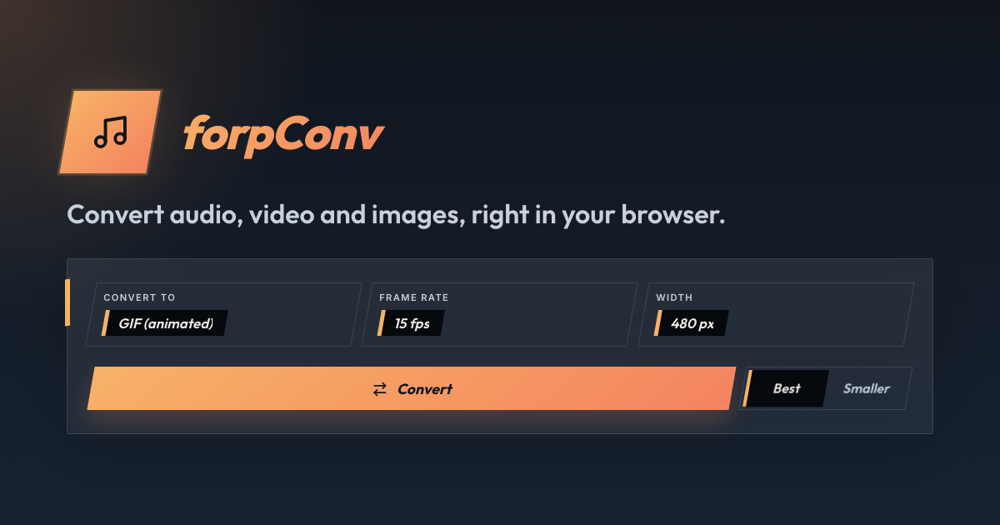

# 🎵 forpConv

Converts audio, video, and images between formats and trims audio or video into iPhone M4R ringtones right in the browser, built with Vue and ffmpeg.wasm. Files never leave the device.

**Live:** https://faleonfall.github.io/ForpConv/

## 🔁 Convert

The page opens on the converter. Drop a file, pick the target format and a quality, trim audio, video, or a GIF to the part you need, or pick the frame for a still image, then download the result. Animated GIF and WebP start on the first 5 seconds and stop at 30.

| Input                | Output                                                                                                            |
| -------------------- | ----------------------------------------------------------------------------------------------------------------- |
| Audio                | MP3, M4A, OGG, Opus, FLAC, WAV                                                                                    |
| Video                | MP4, WebM, MOV, animated GIF, animated WebP, a still image of any frame, or any audio format to extract the sound |
| Image, HEIC included | PNG, JPG, WebP, BMP, TIFF, GIF                                                                                    |
| Animated GIF         | any image format, MP4, WebM, MOV, animated WebP                                                                   |

Video encoding runs single threaded in the browser, so long clips take a while.

## 🎚️ Ringtone

Switch to the Ringtone tab, or open the page with `#ringtone`, to make an iPhone ringtone.

1. Drop an audio or video file onto the page, or click to pick one.
2. Drag or resize the highlighted region to choose up to 30 seconds. Play previews only that part.
3. Set the volume boost and the fades. The fade sliders snap to half seconds, hold Shift to move them freely, or click a fade value to type it.
4. Name the ringtone, create it, and download the `.m4r` file.
