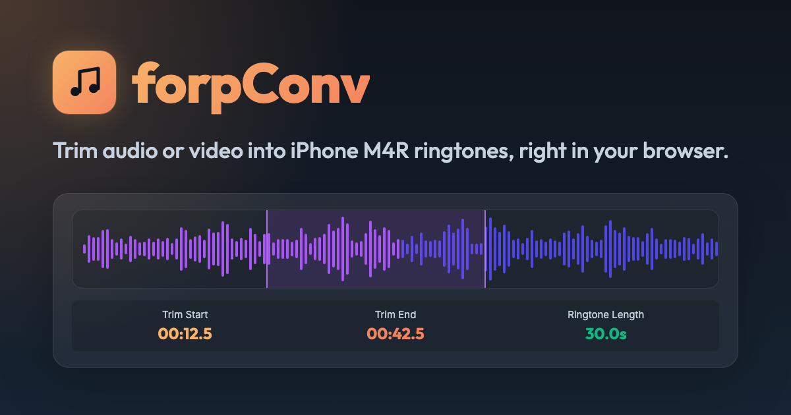

# 🎵 forpConv

Trims audio or video into iPhone M4R ringtones right in the browser, built with Vue and ffmpeg.wasm. Files never leave the device.

**Live:** https://faleonfall.github.io/ForpConv/

## 🎚️ How to use

1. Drop an audio or video file onto the page, or click to pick one.
2. Drag or resize the highlighted region to choose up to 30 seconds. Play previews only that part.
3. Set the volume boost and the fades. The fade sliders snap to half seconds, hold Shift to move them freely, or click a fade value to type it.
4. Name the ringtone, create it, and download the `.m4r` file.
